# Google Cloud Fundamentals: Getting Started with Cloud Storage and Cloud SQL

Lab documentation and implementation files for deploying an Apache/PHP web application on **Compute Engine**, serving static media from **Cloud Storage**, and connecting to a managed MySQL database on **Cloud SQL**.

## Lab Objectives

1. Create a Cloud Storage bucket and upload a publicly readable banner image.
2. Provision and configure a Cloud SQL for MySQL instance.
3. Connect a PHP web application running on Compute Engine to Cloud SQL.
4. Embed the Cloud Storage public object into the web application.

## Architecture & Environment Summary

| Component | Resource / Configuration | Value |
| :--- | :--- | :--- |
| **GCP Project ID** | Lab Project | `qwiklabs-gcp-01-299f2df85339` |
| **Compute Engine VM** | `bloghost` (`e2-standard-2`, Debian 12) | Zone `us-central1-b` |
| **VM Network IPs** | Internal / External IP | `10.128.0.2` / `34.135.118.239` |
| **Cloud Storage Bucket** | `gs://qwiklabs-gcp-01-299f2df85339` | Multi-region `ASIA` |
| **Public Asset** | `my-excellent-blog.png` | ACL `allUsers:R` |
| **Cloud SQL Instance** | `blog-db` (MySQL 8.4 Enterprise Sandbox) | `136.116.215.192:3306` |
| **Database User** | `blogdbuser` | Host `%` |
| **Authorized Network** | `web front end` | `34.135.118.239/32` |

---

## Task 1. Sign in to the Google Cloud Console

Signed in to the Google Cloud Console using the temporary Qwiklabs student credentials and verified the active project (`qwiklabs-gcp-01-299f2df85339`).

---

## Task 2. Deploy a Web Server VM Instance

Provisioned a Compute Engine VM instance named `bloghost` in `us-central1-b` with Apache2 and PHP configured via a startup script:

- **Name**: `bloghost`
- **Region / Zone**: `us-central1` / `us-central1-b`
- **Machine Type**: `e2-standard-2`
- **Boot Disk**: Debian GNU/Linux 12 (bookworm)
- **Firewall**: Allow HTTP traffic (`http-server`)
- **Startup Script** (`scripts/startup.sh`):

```bash
#!/bin/bash
apt-get install apache2 php php-mysql -y
service apache2 restart
```

#### Compute Engine VM Instances Dashboard

Opening Compute Engine > VM instances in project qwiklabs-gcp-01-299f2df85339 before provisioning the bloghost VM.

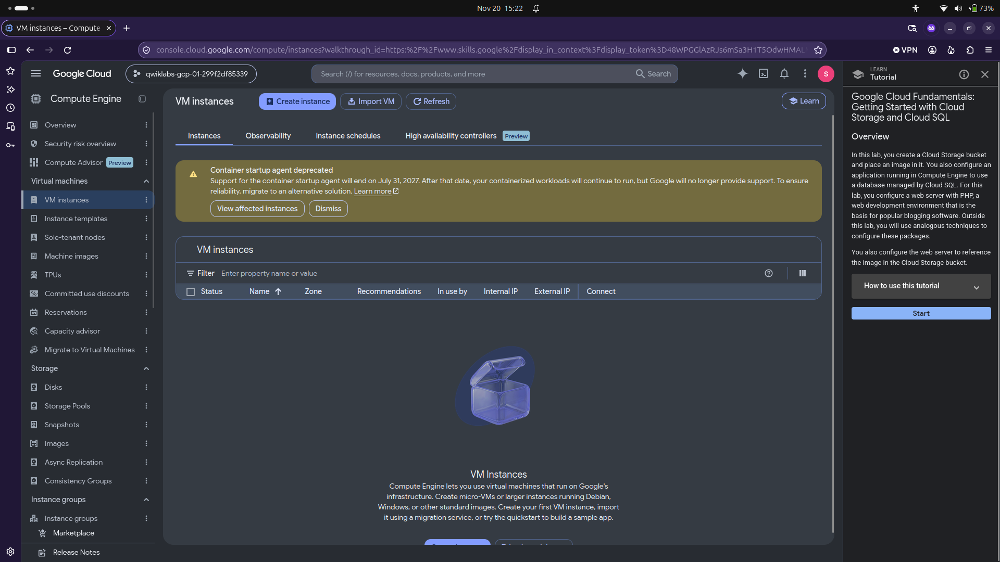

#### Select Debian 12 (bookworm) Boot Disk

Configuring OS and storage for bloghost (e2-standard-2, us-central1-b) by changing the boot disk version to Debian GNU/Linux 12 (bookworm).

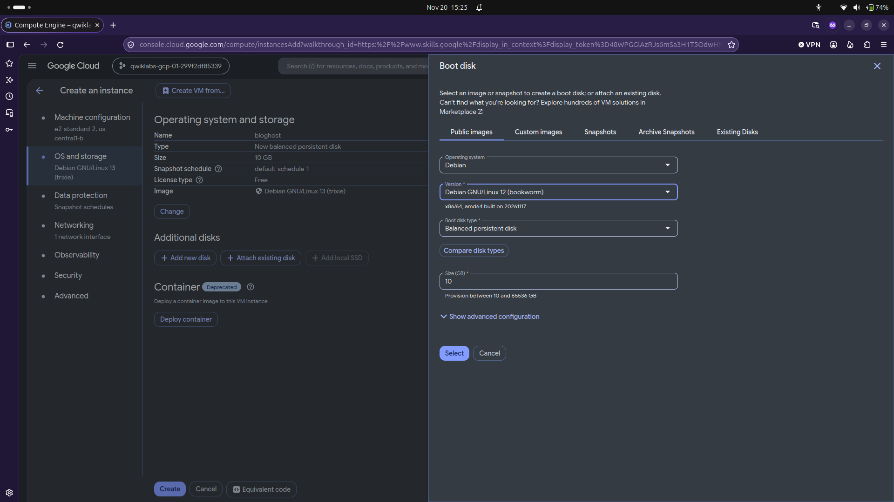

#### Enable HTTP Firewall Rule

Enabling "Allow HTTP traffic" under Networking, adding the http-server network tag for web access.

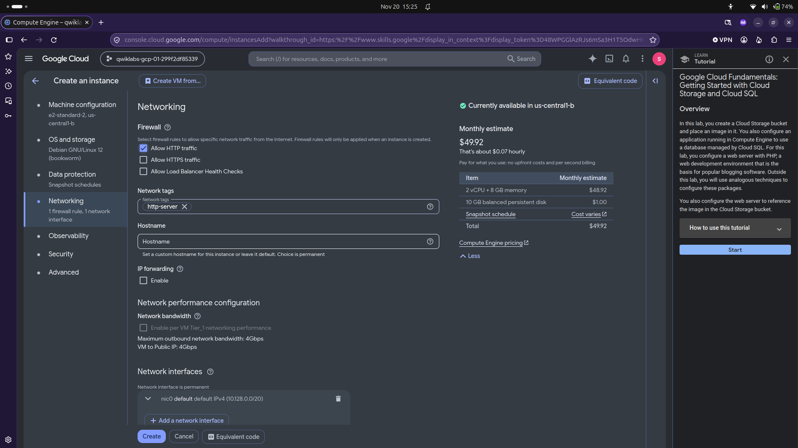

#### Configure Apache & PHP Startup Script

Adding the Bash startup script under Advanced > Automation to install apache2, php, and php-mysql and restart Apache.

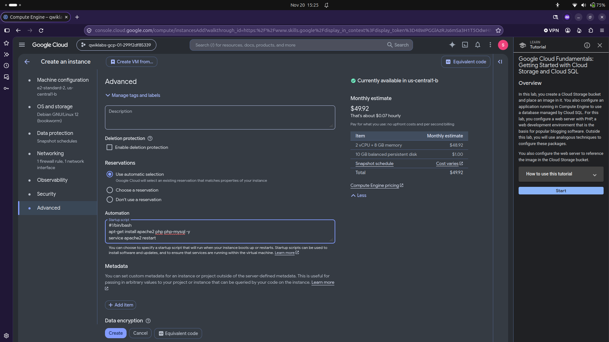

#### VM Running with Internal & External IPs

bloghost provisioned in us-central1-b with Internal IP 10.128.0.2 and External IP 34.135.118.239.

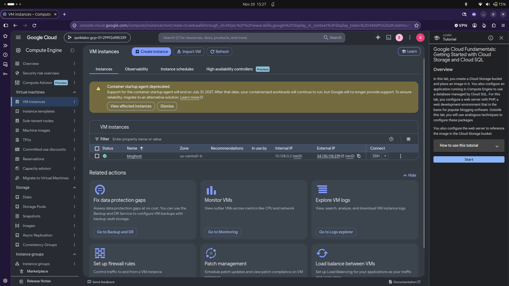

---

## Task 3. Create a Cloud Storage Bucket via Cloud Shell

Activated Cloud Shell, configured the multi-region `LOCATION` variable, created a globally unique bucket matching the project ID, downloaded the sample blog banner, uploaded it to the bucket, and granted public read access:

```bash
export LOCATION=ASIA
gcloud storage buckets create -l $LOCATION gs://$DEVSHELL_PROJECT_ID
gcloud storage cp gs://cloud-training/gcpfci/my-excellent-blog.png my-excellent-blog.png
gcloud storage cp my-excellent-blog.png gs://$DEVSHELL_PROJECT_ID/my-excellent-blog.png
gsutil acl ch -u allUsers:R gs://$DEVSHELL_PROJECT_ID/my-excellent-blog.png
```

#### Activate Cloud Shell & Set Bucket Location

Launching Cloud Shell and exporting LOCATION=ASIA for the multi-region Cloud Storage bucket.

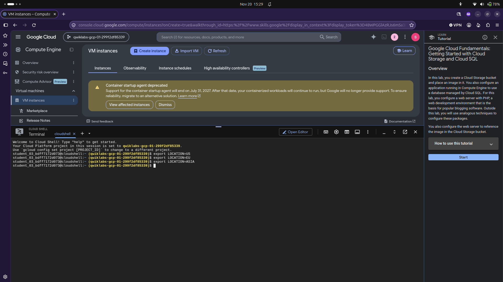

#### Upload Image & Grant Public Read ACL

Copying my-excellent-blog.png to gs://qwiklabs-gcp-01-299f2df85339/ and updating the object ACL to allUsers:R.

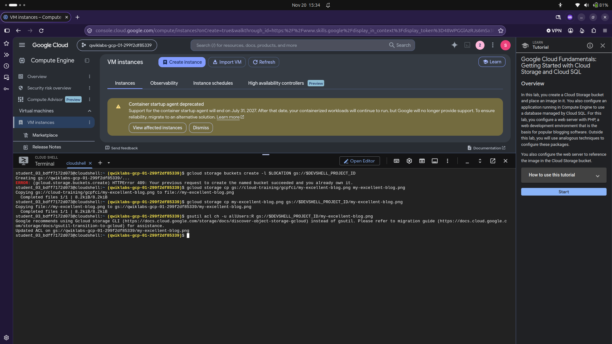

---

## Task 4. Create and Configure the Cloud SQL Instance

Created a managed MySQL 8.4 instance (`blog-db`) using Cloud SQL Enterprise (Sandbox preset) in the same region/zone as `bloghost` for low-latency communication:

- **Instance ID**: `blog-db`
- **Region / Zone**: `us-central1` / `us-central1-b` (Single zone)
- **Security**: Enabled `Allow unencrypted network traffic` for non-SSL lab testing
- **Database User**: `blogdbuser`
- **Authorized Network**: `web front end` (`34.135.118.239/32`)

#### Choose MySQL Database Engine

Selecting MySQL as the database engine in Cloud SQL Create an instance.

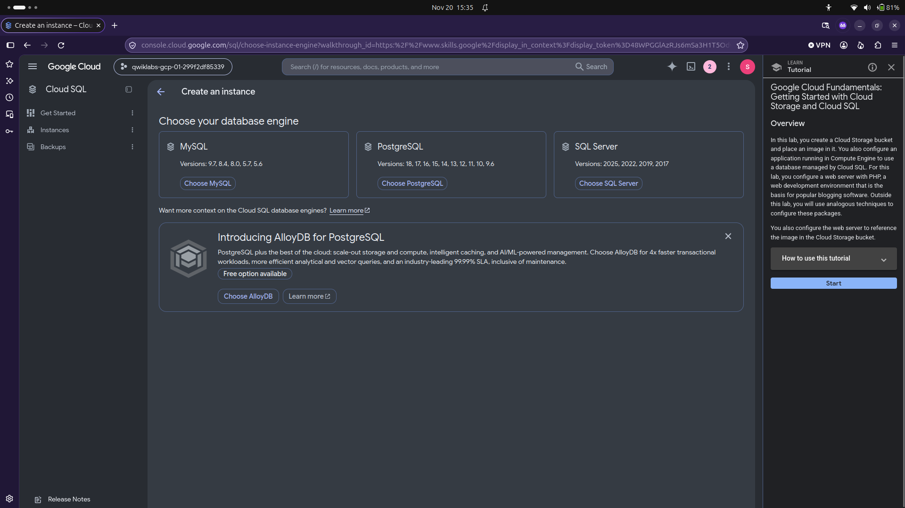

#### Select Enterprise Edition & Sandbox Preset

Configuring Cloud SQL Enterprise edition with the Sandbox preset (MySQL 8.4, db-custom-2-8192, us-central1).

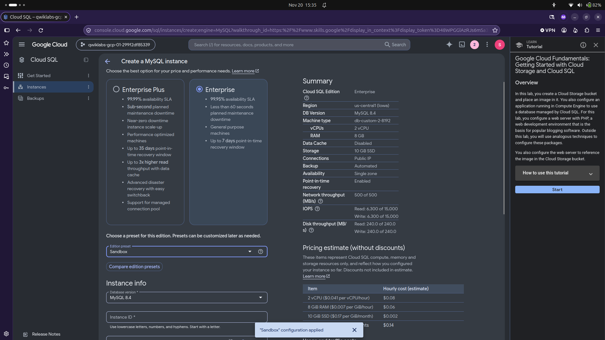

#### Allow Unencrypted Network Traffic

Selecting "Allow unencrypted network traffic (not recommended)" under Security so the PHP PDO client can connect without SSL certificates in the lab.

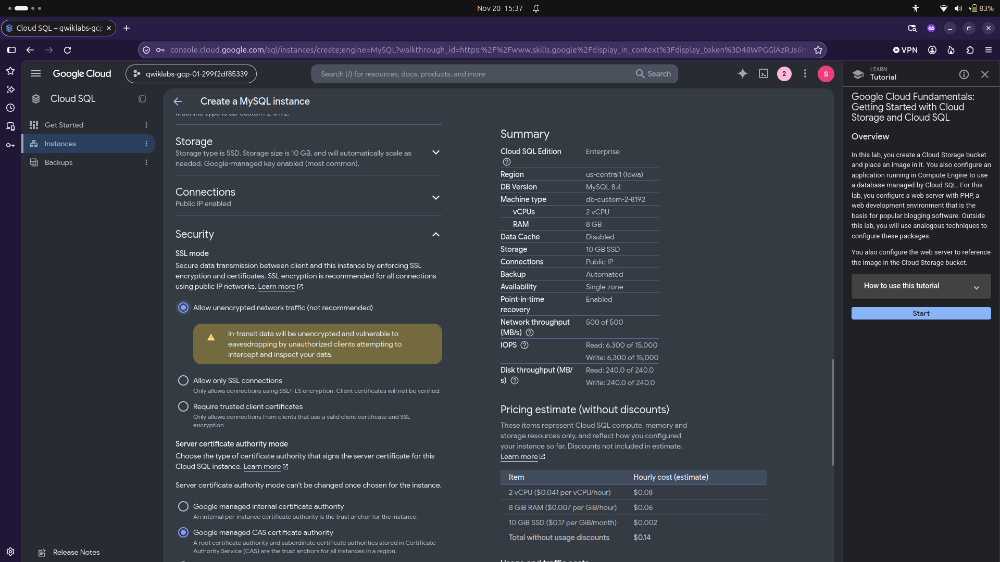

#### Copy Cloud SQL Public IP Address

Configurations view showing blog-db Public IP address 136.116.215.192 and connection name qwiklabs-gcp-01-299f2df85339:us-central1:blog-db.

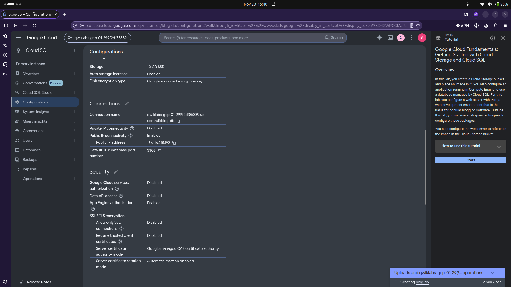

#### Create Built-in User blogdbuser

Adding database user account blogdbuser with built-in authentication and Allow any host (%) access.

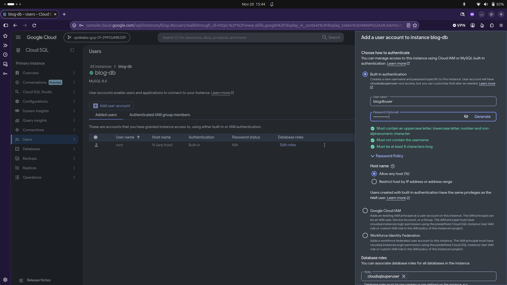

#### Verify blogdbuser Account Added

Users list confirming blogdbuser (% any host) is active on blog-db.

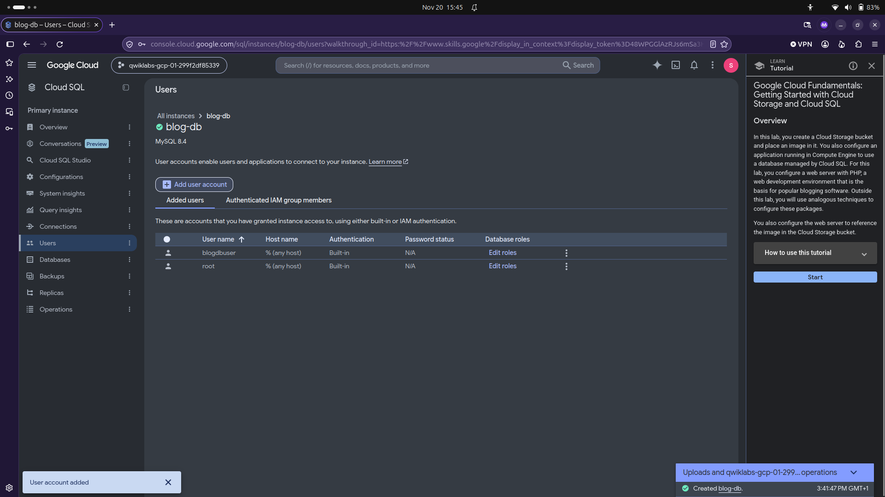

#### Authorize bloghost External IP (/32)

Authorized network "web front end" configured with bloghost external IP CIDR 34.135.118.239/32.

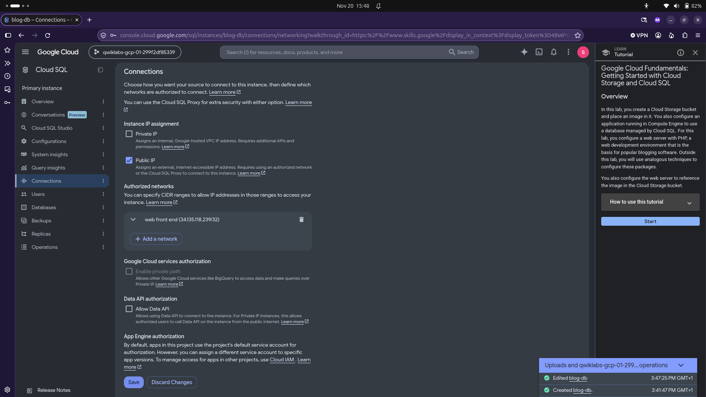

---

## Task 5. Connect the Compute Engine PHP App to Cloud SQL

Connected to `bloghost` via SSH-in-browser, navigated to `/var/www/html`, and created `index.php` using PHP PDO to connect to Cloud SQL:

```bash
cd /var/www/html
sudo nano index.php
sudo service apache2 restart
```

Initial verification against `http://34.135.118.239/index.php` confirmed PHP execution before substituting `136.116.215.192` and `Passw0rd1!`.

#### SSH into bloghost Document Root

Connecting to bloghost via SSH-in-browser and changing directory to /var/www/html.

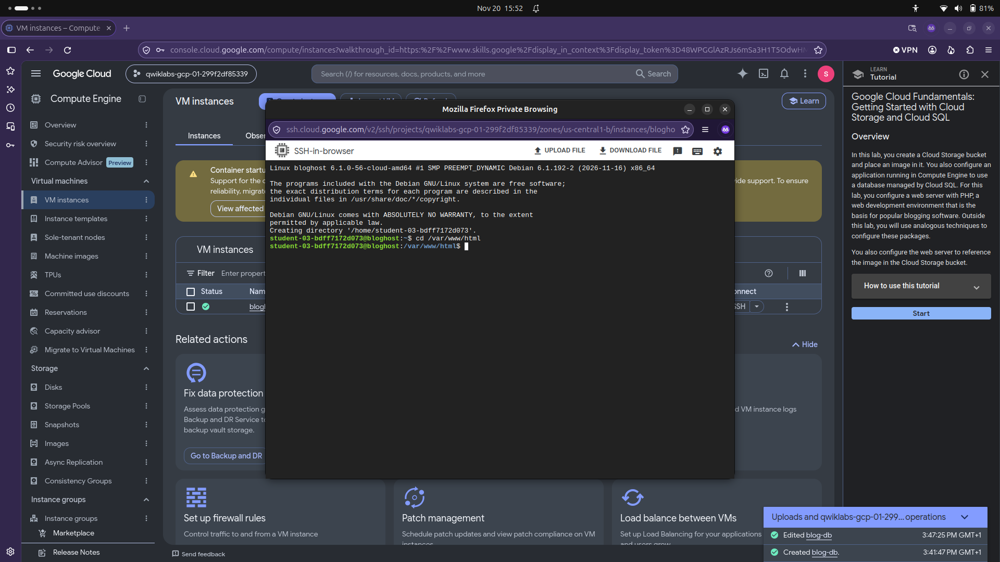

#### Initial index.php with Placeholder Credentials

Creating index.php with PDO MySQL connection logic using placeholder CLOUDSQLIP and DBPASSWORD values.

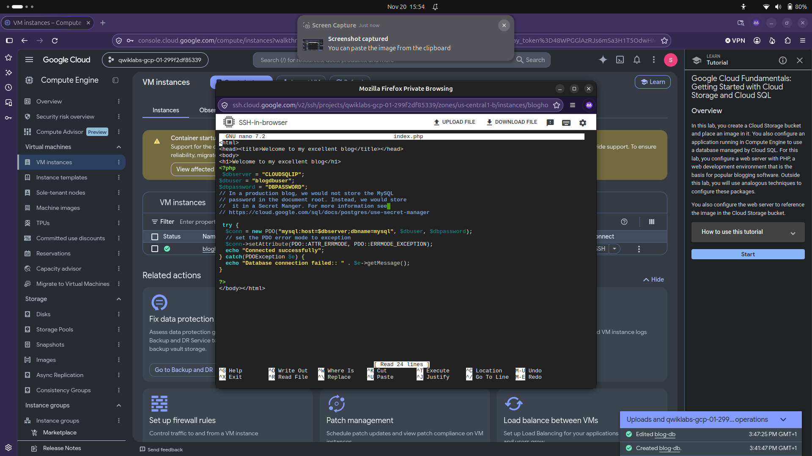

#### Expected Initial Connection Failure

Visiting http://34.135.118.239/index.php confirms PHP is active and displays the expected getaddrinfo error for placeholder CLOUDSQLIP.

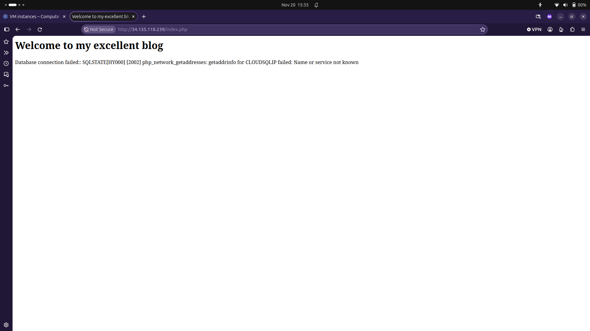

#### Update index.php with Cloud SQL IP & Password

Replacing CLOUDSQLIP with 136.116.215.192 and DBPASSWORD with the configured database password.

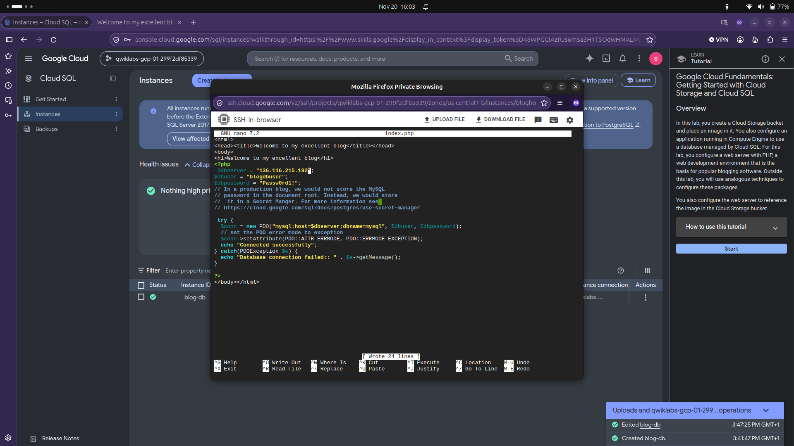

---

## Task 6. Integrate the Cloud Storage Banner Image

Retrieved the public URL for `my-excellent-blog.png` from the Cloud Storage Console and inserted the `` tag above the `<h1>` heading in `/var/www/html/index.php`:

```php

<h1>Welcome to my excellent blog</h1>
```

#### Inspect Bucket in Cloud Storage Console

Cloud Storage > Buckets displaying qwiklabs-gcp-01-299f2df85339 in asia multi-region with object-level ACLs.

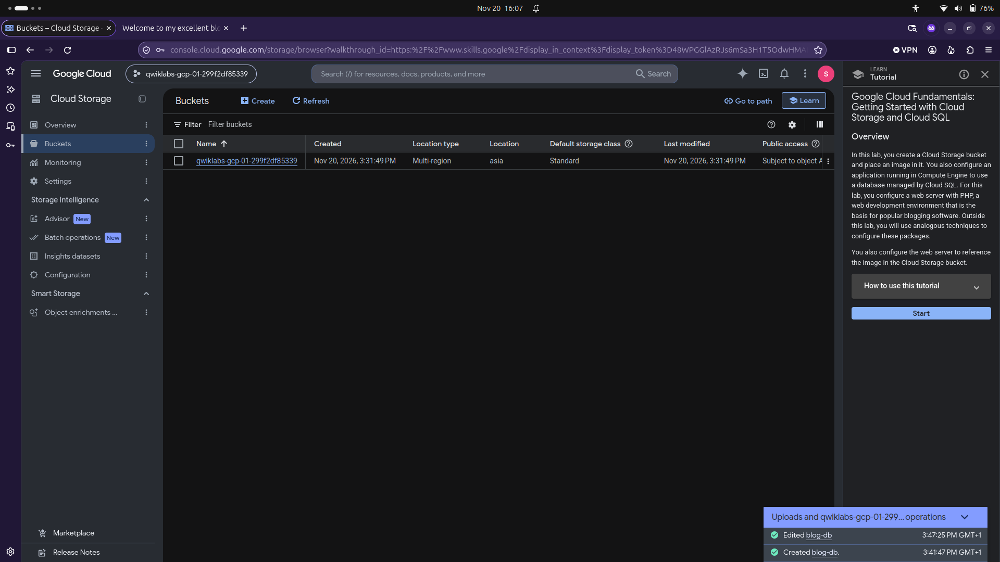

#### Copy Public Object URL

Copying the public link for my-excellent-blog.png ("Access granted to public principals") from the Cloud Storage browser.

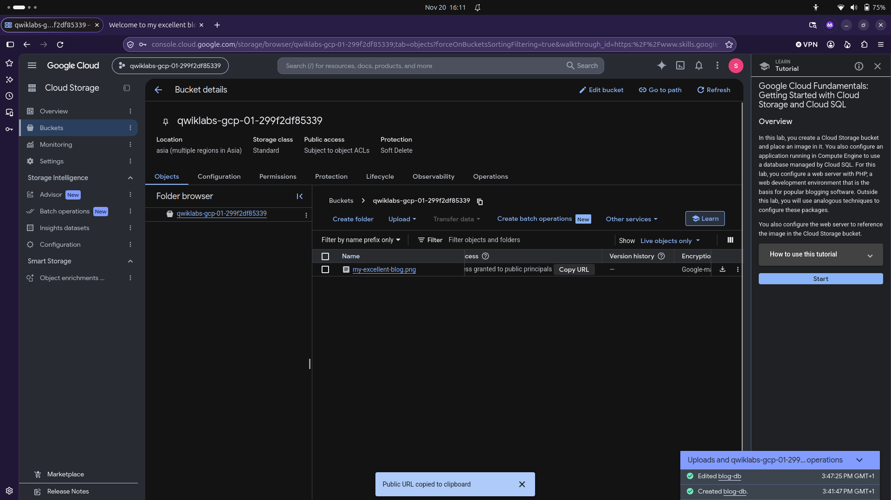

#### Final Blog Page Serving Cloud Storage Banner

Reloading http://34.135.118.239/index.php renders the "My Excellent Blog" banner image directly from Cloud Storage.

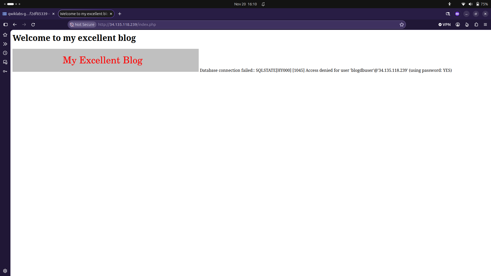

---

## Troubleshooting Notes

- **`gsutil acl ch` returns `CommandException: No URLs matched`**: Ensure the file is copied to the bucket (`gcloud storage cp my-excellent-blog.png gs://$DEVSHELL_PROJECT_ID/my-excellent-blog.png`) before applying public-read ACL permissions.
- **`SQLSTATE[HY000] [2002] php_network_getaddresses`**: Expected during Task 5 verification before replacing the placeholder `CLOUDSQLIP` string in `/var/www/html/index.php`.
- **`SQLSTATE[HY000] [1045] Access denied for user`**: Verify that the database user password in `index.php` matches the built-in password configured for `blogdbuser` in Cloud SQL > Users and that `34.135.118.239/32` is saved under Connections > Networking > Authorized networks.

## Security Note

> In a production deployment, never store database credentials directly in the web document root or commit live passwords to source control. Use [Google Cloud Secret Manager](https://cloud.google.com/sql/docs/mysql/use-secret-manager), Private IP / Cloud SQL Auth Proxy, and enforced SSL/TLS connections.
